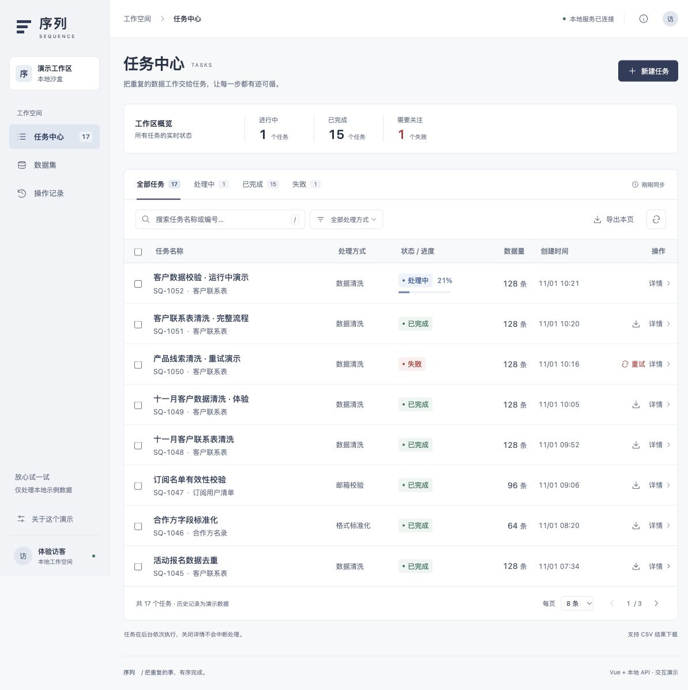
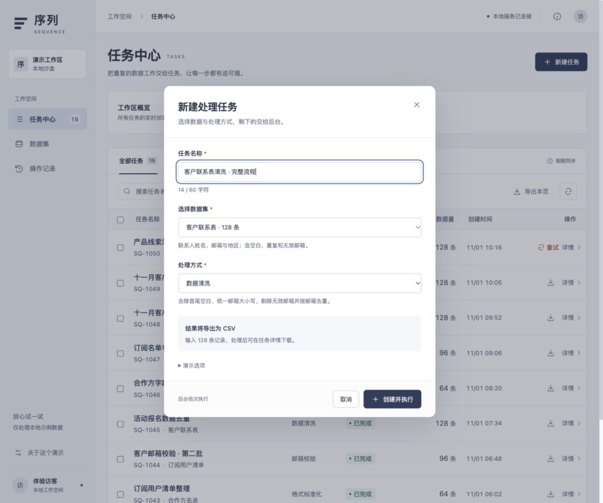
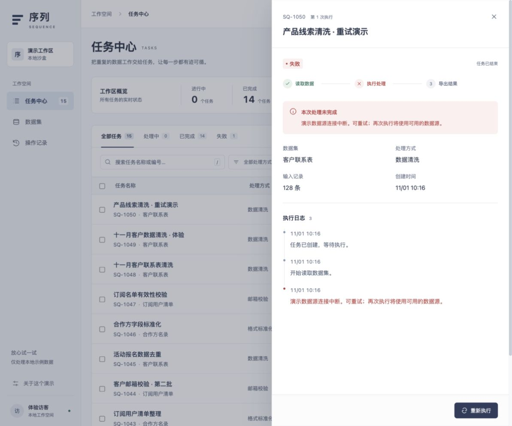
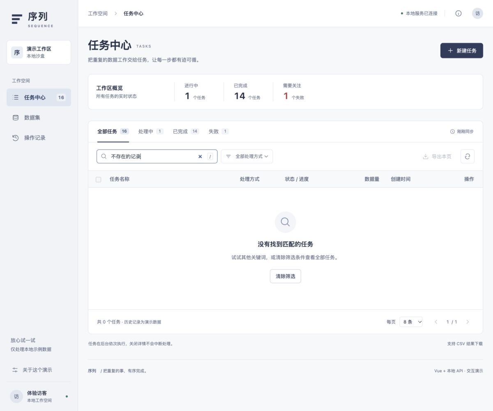
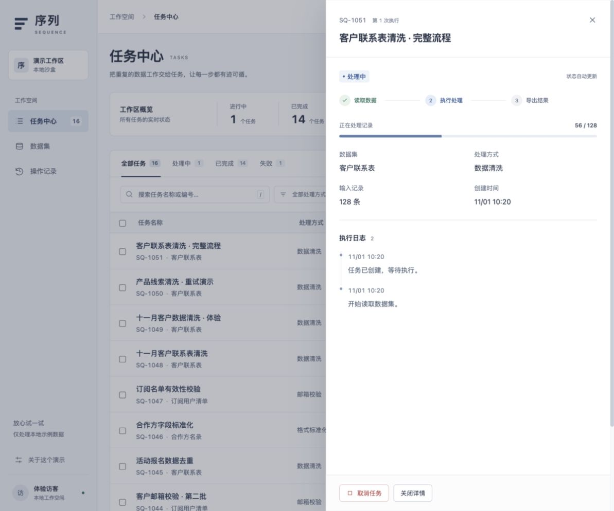

# 序列 · 批量任务工作台 | Sequence · Batch Task Workbench

一个用于展示前端工具平台设计与交互的 Vue 3 + Node.js 本地演示。它包含真实的本地 API 和任务处理流程，适合阅读、运行与讨论；**不是生产级 SaaS，也没有可访问的线上演示**。

A local Vue 3 + Node.js demo for exploring the design and interaction patterns of a batch-processing tool. It includes a working local API and task-processing flow for review and experimentation. **It is not a production SaaS, and no hosted demo is provided.**

## 界面截图 | Screenshots

### 任务列表与筛选 | Task list and filters


### 创建任务与校验 | Create task and validation


### 失败恢复 | Failure recovery


### 空状态 | Empty search results


### 任务执行 | Task progress


## 功能 | Features

- 任务列表：搜索、类型与状态筛选、分页，以及按当前页或所选任务导出 CSV。
- 新建任务：表单校验、防重复提交、数据集与处理方式选择。
- 任务执行：本地 Node 服务排队处理数据，并记录进度与日志。
- 任务详情：查看进度、失败原因、重试、取消、结果预览与 CSV 下载。
- 数据集和操作记录：使用明确标注的生成式示例数据。
- Task workspace with search, type and status filters, pagination, and CSV export.
- Task creation with validation, duplicate-submit protection, and dataset/operation selection.
- A local Node service processes queued tasks and records progress and logs.
- Task details include failure recovery, retry/cancel actions, result preview, and CSV download.
- Dataset and activity views use clearly identified generated sample data.

## 本地运行 | Run locally

需要 Node.js 22.12 或更高版本。两个本地服务只绑定 `127.0.0.1`。

Requires Node.js 22.12 or newer. Both local services bind to `127.0.0.1` only.

```bash
npm ci
npm run dev
```

打开 http://127.0.0.1:18750 。API 服务位于 http://127.0.0.1:18751 。

Open http://127.0.0.1:18750 . The API runs at http://127.0.0.1:18751 .

```bash
npm test
npm run build
npm start
```

`npm start` 用于本机生产预览；运行前先执行 `npm run build`。

`npm start` serves a local production preview; run `npm run build` first.

## 项目结构 | Project structure

- `src/App.vue`：任务中心、数据集、操作记录，以及表单与详情交互。
- `src/StatusBadge.vue`、`src/Icon.vue`：状态和操作图标组件。
- `src/style.css`：主题变量、布局、表格、表单及状态样式。
- `server/store.mjs`：示例数据、任务状态机、处理逻辑与本地 JSON 持久化。
- `server/index.mjs`：Node 原生 HTTP API 与本机静态预览服务。
- `test/api.test.mjs`：数据处理和 API 流程测试。
- `PRODUCT.md`、`DESIGN.md`、`UI-REVIEW.md`：产品背景、设计规范和审查记录。

## 数据与安全边界 | Data and security boundaries

- 所有演示数据均在本地生成；运行状态保存在 `var/tasks.json`，该目录已加入 Git 忽略规则。
- 项目没有登录、角色权限或多租户隔离，不支持外部数据源和文件上传。
- 本地来源检查不是身份验证或服务端授权。不要把服务监听地址改成公网地址后直接部署。
- CSV 导出和服务端处理没有针对任意不可信生产数据完成全面安全加固。将其视为学习与展示项目，不要用于生产业务数据。
- Generated demo data stays local; runtime state is written to the ignored `var/tasks.json` directory.
- This project has no authentication, role-based access control, or tenant isolation. It does not support external data sources or file uploads.
- The local-origin check is not authentication or server-side authorization. Do not expose the service to the public internet.
- CSV export and server-side processing are not comprehensively hardened for arbitrary untrusted production data. Treat this as a learning and portfolio demo, not a production tool.

更多实现说明见 `DESIGN.md` 和 `UI-REVIEW.md`。/ See `DESIGN.md` and `UI-REVIEW.md` for implementation notes.

## 许可 | License

MIT，详见 [`LICENSE`](LICENSE)。/ MIT; see [`LICENSE`](LICENSE).
